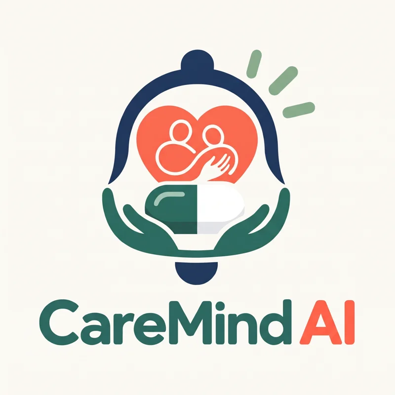
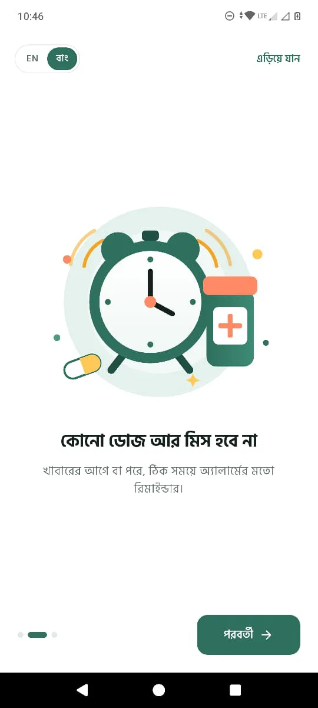
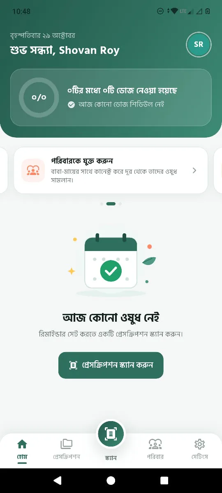
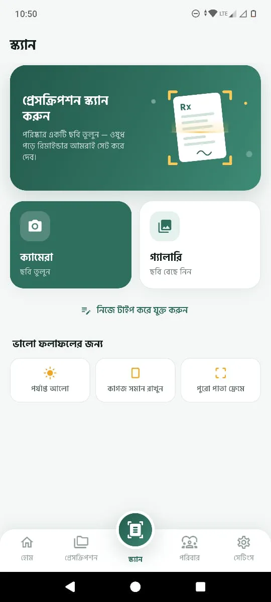
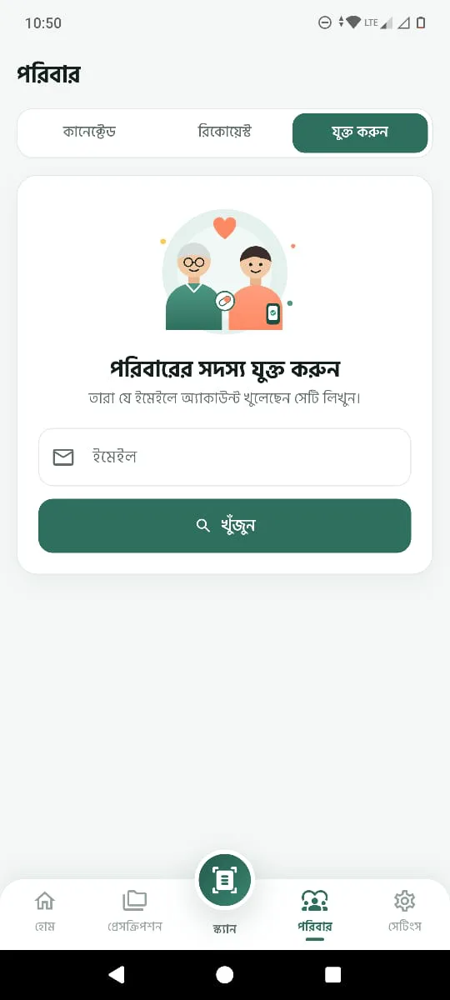

<p align="center">
  
</p>

<h1 align="center">CareMind AI — Intelligent Elderly Care</h1>

<p align="center">
  An AI prescription-to-reminder platform that helps elderly people take the right medicine at the right time, and lets their families know.<br>
  <b>Bangladesh AI Business Summit 2026 · American International University-Bangladesh (AIUB)</b>
</p>

<p align="center">
  <a href="https://caremindai.github.io/home/"><b>🌐 Website</b></a> ·
  <a href="https://github.com/CareMindAI/home/releases/latest"><b>📱 Download Android APK</b></a>
</p>

---

## The problem
Elderly patients guess, double or miss doses from handwritten prescriptions, and their families cannot see it.
1 in 2 long-term patients don't take medicine as prescribed (WHO), and 1.53 crore Bangladeshis are aged 65+.

## Our solution
One photo of the prescription becomes a daily reminder schedule — and the family sees every dose.

| Step | What happens | Status |
|---|---|---|
| 1. Scan | Take one photo of the handwritten prescription | ✅ Working |
| 2. AI reads, you confirm | Medicines, 1-0-1 pattern, food timing and days appear; check and edit | ✅ Working |
| 3. Remind | The phone rings at each dose; tap taken or missed | ✅ Working |
| 4. Family knows | Relatives see taken / missed doses and get alerts (SMS & voice-call fallback) | 🛠 Planned |

**7 of 11** planned capabilities already work in the Android prototype, with a Bangla-first interface.

## Screenshots
<p>
  
  
  
  
</p>

## Team
- **Sk. Muktadir Hossain** — Team Lead ([muktadir@aiub.edu](mailto:muktadir@aiub.edu))
- Mahmudul Haque Shakir
- Shovan Roy
- Riya Das
- Rahat Rihan

**Supervisor:** Dr. Mohammad Saef Ullah Miah, Associate Professor, Department of Computer Science; Director, Faculty of Science and Technology, AIUB.

---

## About this repository
This repo hosts the project website — a static site (plain HTML, CSS and JS, no build step).

```
index.html            the whole page
assets/css/style.css  styles (light + dark mode, responsive)
assets/js/main.js     menu, scroll animations, screenshot slider
assets/img/           logo, screenshots, supervisor photo
.nojekyll             tells GitHub Pages to serve files as-is
```

### Run locally
```bash
python3 -m http.server 8000
```
Then open http://localhost:8000.

### Publish with GitHub Pages
1. Push these files to the `main` branch of `CareMindAI/home`.
2. On GitHub: **Settings → Pages → Build and deployment → Source: Deploy from a branch**, choose `main` and `/ (root)`, then **Save**.
3. After a minute the site is live at **https://caremindai.github.io/home/**.

### Publish the Android APK
The **Download APK** button points to
`https://github.com/CareMindAI/home/releases/latest/download/CareMindAI.apk`, so the APK goes in a GitHub Release (not in the repo itself — it is 66 MB):

1. On GitHub: **Releases → Draft a new release**, tag `v1.0.0`, title `CareMind AI v1.0.0`.
2. Attach the APK and **name the file exactly `CareMindAI.apk`** (rename `app-release.apk` first).
3. **Publish release.** Every new release with a file of that name automatically becomes the download.

---

> CareMind AI supports medication routines; it does not replace a doctor. Statistics are the sources' own claims, accessed 11–15 October 2026.
